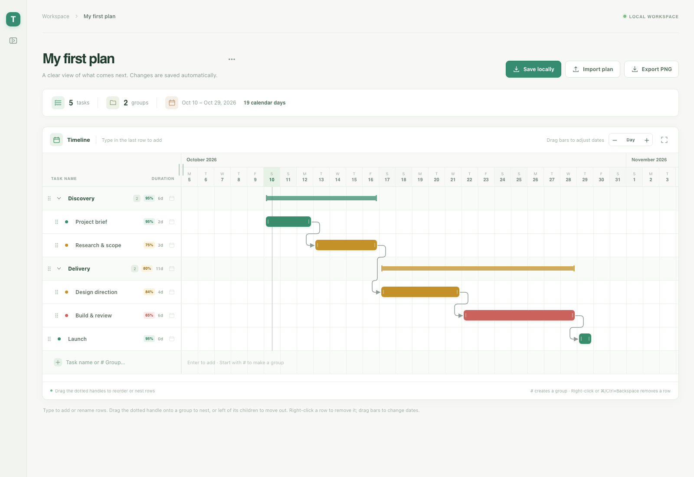

# Threadline

A private, local Gantt chart creator. Plans and tasks live in this browser's `localStorage`; there is no account, backend, or network service required by the app. Drag task bars sideways to change dates or drag task and group bars vertically to reorder and nest rows; the name list follows the timeline. Use **Save locally** to download the active plan as a `.threadline.json` file. **Import plan** accepts either a file upload or pasted JSON and offers a copyable or downloadable prompt for an AI agent to generate a compatible plan from your Markdown tasks. Existing plans saved as Daymark are carried over automatically on the same browser origin.



## Run locally

Requires Node.js 22 or newer.

```sh
npm install
npm run dev
```

Open the URL shown by Vite (normally **http://localhost:5173**). For a production build, run `npm run build` followed by `npm run preview`.

## Run with Docker

```sh
docker build -t threadline .
docker run --rm -p 8080:80 threadline
```

Open **http://localhost:8080**. Docker must be running. Browser storage is tied to the browser origin: plans at `localhost:5173` and `localhost:8080` are separate, and clearing browser site data removes them.
